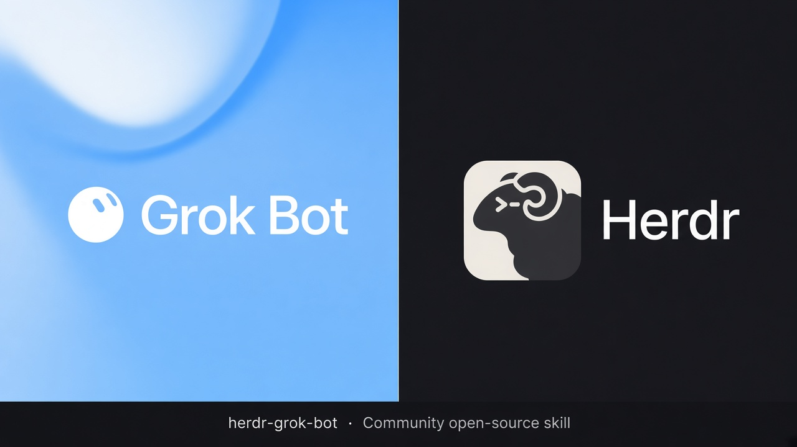
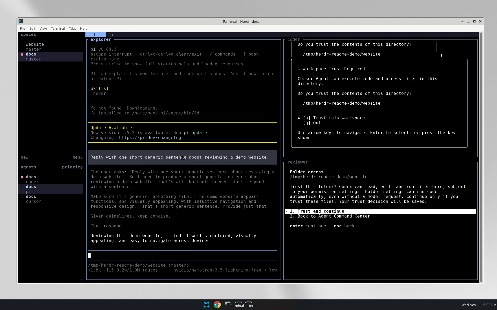
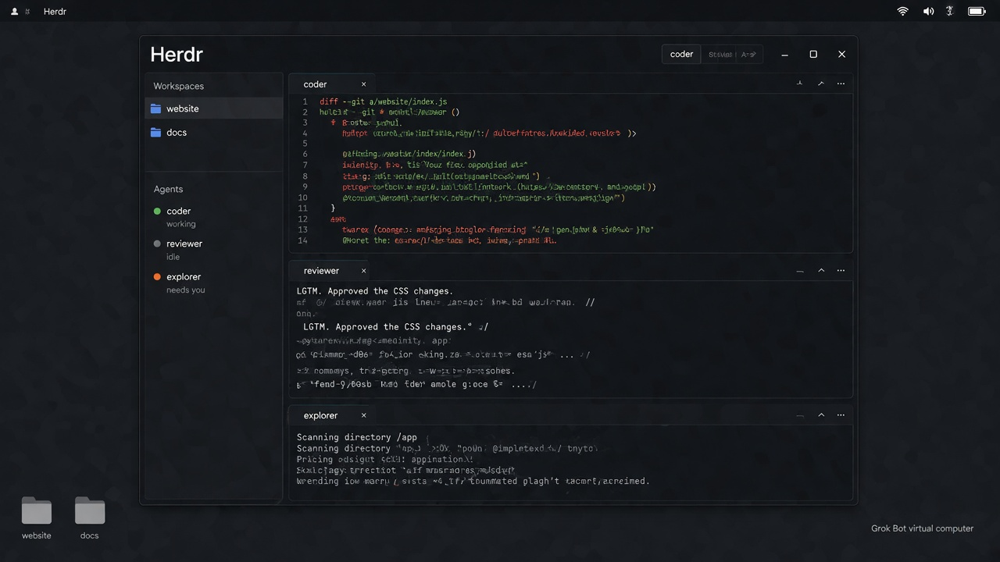

# herdr-grok-bot

給 [Grok Bot](https://grok.com) 使用的開放技能。當 Bot 要啟動本機互動式 CLI Agent（例如 Codex、Cursor、Antigravity、Claude Code、Pi，或 Herdr 支援的其他類型）時，改經 [Herdr](https://herdr.dev) 啟動與監督，讓你可以在同一個終端介面看見每個 Agent 的狀態、所屬 Workspace，並隨時介入。

本專案不是 Herdr 或 xAI 的官方產品。Herdr 請從 [herdr.dev](https://herdr.dev) 安裝。

## 這是做什麼的

許多人知道 Grok Bot 會使用 CLI，但在背景執行的 CLI Agent，平常不容易一次看清楚。

Herdr 是可以同時開啟多個 Agent 的終端工具之一。它能在同一個介面顯示每個背景 CLI Agent 的工作狀態（例如正在執行、閒置、暫停），以及這個 Agent 屬於哪一個 Workspace、由哪一個 Bot 使用，方便管理更複雜的 Agent 協作。

把這個技能交給你的 Grok Bot 之後，只要 Bot 要啟動本機互動式 CLI Agent，就會改經 Herdr 啟動，讓你能直接在 Herdr 裡瀏覽與介入。

下圖是在 Grok Bot 虛擬電腦桌面上拍攝的真實 Herdr 畫面。

下圖是依品牌元素生成的示意畫面，僅供說明，終端文字並非真實介面。

## 技能如何運作

這是一份輕量技能，主指令刻意寫得很短。Bot 每次要使用 CLI Agent 時會讀入技能，再依情況查看對應文件：

- 如果尚未安裝 Herdr，請讀 `INSTALL.md`，依官方文件安裝，並部署 Herdr 官方 Skills。
- 如果已經安裝，請讀 `USAGE.md`，用原生 Herdr 命令啟動與監督 CLI Agent。一般情況到這裡就結束。
- 只有在你希望透過 Herdr 讓 CLI Agent 互相溝通或串連任務時，才改看 Herdr 官方 Skills。

請把整個資料夾一起加到技能庫，讓 `INSTALL.md` 和 `USAGE.md` 留在 `SKILL.md` 旁邊。不要只貼主技能而漏掉這兩份文件。

## 如何使用

1. 下載或 clone 這個倉庫。
2. 對你的 Grok Bot 說類似下面這句：

> 請把這個資料夾整個加到我的技能庫，名稱用 `herdr-grok-bot`，並保留資料夾裏的 `INSTALL.md` 和 `USAGE.md`。這是給 Grok Bot 用的外部操作約定，不要覆寫我其他已有技能，亦不要把其他電腦的路徑寫進技能裏。如果這部機器還沒有 Herdr，先按官方文件幫我安裝，並部署 Herdr 的官方 Skills。只記住你在我這部機器上核實過的設定。

3. 之後在專案目錄執行 `herdr`，就可以在 Herdr 裡面看到 Bot 啟動的 CLI Agent。

## 倉庫裡有什麼

- `SKILL.md`：極短的主技能。只說明何時檢查、何時安裝、何時啟動，以及何時改看官方 Skills。
- `INSTALL.md`：尚未安裝 Herdr 時先讀。內容包括官方安裝命令，以及部署 Herdr 官方 Skills。
- `USAGE.md`：已經安裝時先讀。用原生 Herdr 命令啟動與監督 CLI Agent。
- `docs/hero.jpg`：封面。
- `docs/herdr-desktop.png`：在 Grok Bot 虛擬電腦上拍攝的真實畫面。
- `docs/illustrated-desktop.jpg`：生成的示意畫面，僅供說明。
- `LICENSE`：MIT 授權。

## 這個技能不會做什麼

- 它不會攔截普通、短暫的 Shell 指令。
- 它不會改寫 Grok Bot 本身已經用雲端編程 Agent 處理的 repository 工作。
- 它不會自行發明 CLI Agent 互相溝通的方法；那一部分請使用 Herdr 官方 Skills。
- 它不是硬攔截器，因此不能保證每個 Bot 每次都會遵循。實際命令以你安裝的 `herdr` 與官方文件為準。

## 官方連結

- [Herdr](https://herdr.dev)
- [Herdr TUI](https://herdr.dev/tui/)
- [Quick start](https://herdr.dev/tui/docs/quick-start/)
- [Agent automation](https://herdr.dev/tui/docs/agent-automation/)
- [Agent skill](https://herdr.dev/tui/docs/agent-skill/)
- [Install](https://herdr.dev/tui/docs/install/)

## 授權

本專案以 MIT 授權釋出，詳見 `LICENSE`。

## 聲明

本專案是社群提供的 Grok Bot 技能，不是 Herdr、xAI 或 Cursor 的官方產品，也不代表上述單位的背書或合作。產品名稱與商標屬於各自的權利人。封面與示意畫面以 Grok 生成（Created with Grok）；真實截圖除外。

---

# English

A community skill for [Grok Bot](https://grok.com). When the bot is about to start a local interactive CLI agent such as Codex, Cursor, Antigravity, Claude Code, Pi, or another kind Herdr supports, it should launch and supervise that agent through [Herdr](https://herdr.dev). You can then see each agent's status, workspace and conversation in one terminal interface, and step in when needed.

This project is not an official Herdr or xAI product. Install Herdr from [herdr.dev](https://herdr.dev).

## What it is for

Many people know that Grok Bot can use a CLI, but background CLI agents are usually hard to see in one place.

Herdr is one of the terminal tools that can show several CLI agents at once. In a single interface you can see whether each background agent is working, idle or paused, which workspace it belongs to, and which bot is using it. That makes it easier to manage more complex agent setups.

After you add this skill, your Grok Bot should start local interactive CLI agents through Herdr, so you can watch and intervene there.

The image below is a real screenshot of Herdr running on a Grok Bot virtual computer desktop.

The next image is a generated illustration for context only. The terminal text is not a real Herdr interface.

## How the skill works

This is a lightweight skill. The main instructions stay short. The bot loads the skill whenever it is about to use a CLI agent, then opens only the file that the current case needs:

- If Herdr is not installed, read `INSTALL.md`. Install Herdr from the official docs, and also install Herdr's official skills.
- If Herdr is already installed, read `USAGE.md` and start the CLI agent with native Herdr commands. That is the normal path, and it should usually end there.
- Only if you want CLI agents to communicate or chain work through Herdr should the bot point those agents to Herdr's official skills.

Add the whole folder to the skill library so `INSTALL.md` and `USAGE.md` stay beside `SKILL.md`. Do not paste only the main skill and leave the helper files behind.

## How to use it

1. Download or clone this repository.
2. Tell your Grok Bot something like this:

> Please add this whole folder to my skill library as `herdr-grok-bot`, and keep `INSTALL.md` and `USAGE.md` beside the skill. This is an external convention for Grok Bot. Do not overwrite my other skills, and do not write another computer's paths into the skill. If Herdr is not installed on this machine, help me install it from the official docs and also install Herdr's official skills. Remember only settings you verified on this machine.

3. From a project directory, run `herdr`. You should then see the CLI agents your bot starts inside Herdr.

## What's in this repo

- `SKILL.md`: the short main skill. It only says when to check, when to install, when to start an agent, and when to consult the official skills.
- `INSTALL.md`: read this if Herdr is not installed. It covers official install commands and installing Herdr's official skills.
- `USAGE.md`: read this if Herdr is already installed. It covers starting and supervising CLI agents with native Herdr commands.
- `docs/hero.jpg`: the cover image.
- `docs/herdr-desktop.png`: a real screenshot taken on a Grok Bot virtual computer.
- `docs/illustrated-desktop.jpg`: a generated illustration, for context only.
- `LICENSE`: MIT.

## What this skill does not do

- It does not intercept ordinary, short Shell commands.
- It does not change repository work that Grok Bot already routes through a cloud coding agent.
- It does not invent its own way for CLI agents to talk to each other; use Herdr's official skills for that.
- It is not a hard interceptor, so it cannot guarantee that every bot will follow it every time. Prefer the `herdr` binary you installed and the official docs.

## Official Herdr links

- [Herdr](https://herdr.dev)
- [Herdr TUI](https://herdr.dev/tui/)
- [Quick start](https://herdr.dev/tui/docs/quick-start/)
- [Agent automation](https://herdr.dev/tui/docs/agent-automation/)
- [Agent skill](https://herdr.dev/tui/docs/agent-skill/)
- [Install](https://herdr.dev/tui/docs/install/)

## License

This project is released under the MIT License. See `LICENSE`.

## Disclaimer

This is a community skill for Grok Bot. It is not an official Herdr, xAI, or Cursor product, and it does not imply endorsement or partnership by those parties. Product names and trademarks belong to their respective owners. The cover and the illustrated desktop image were created with Grok; the real screenshot was not.
